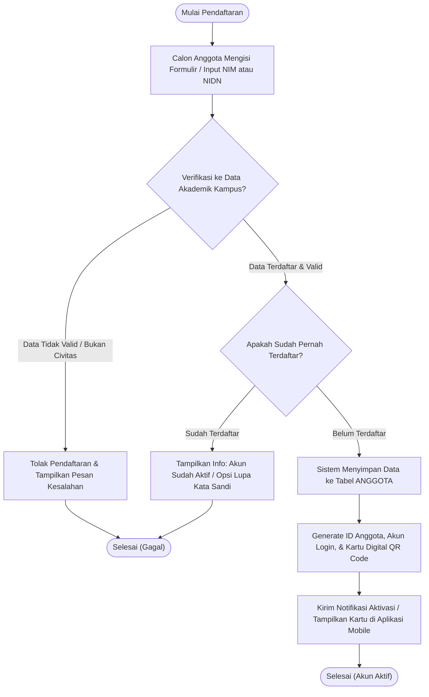
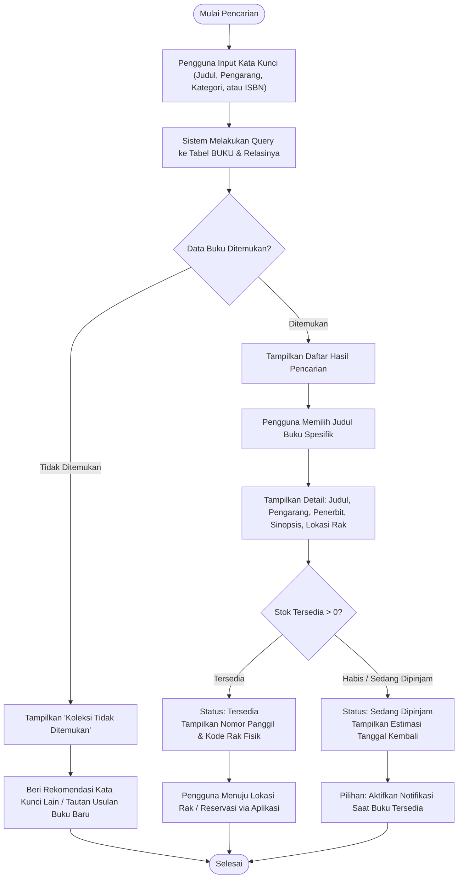
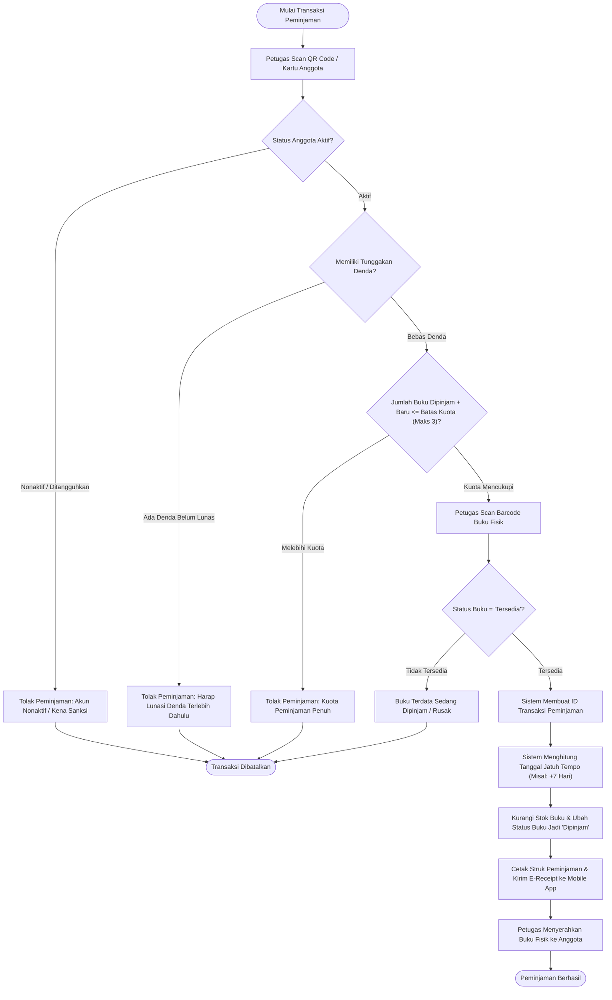
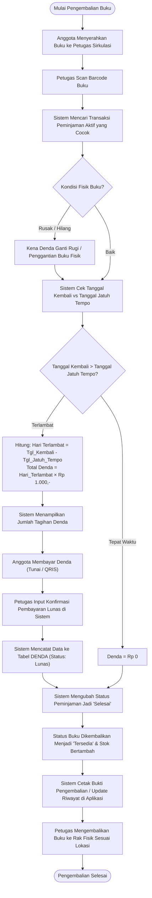
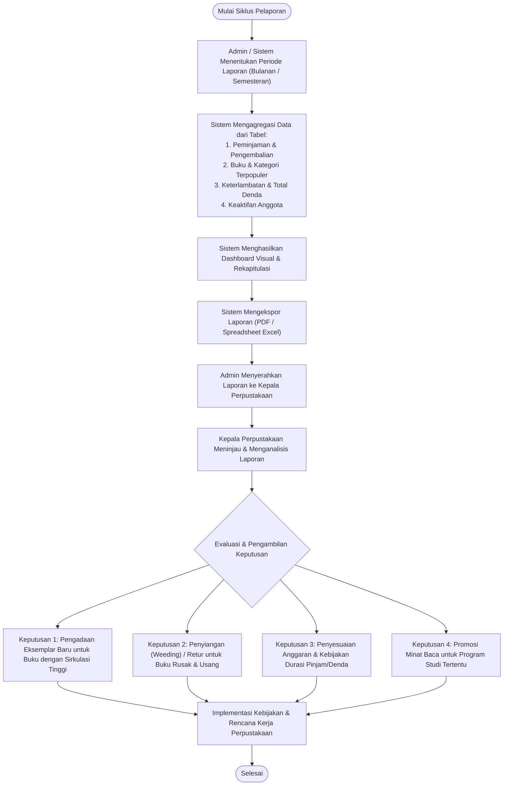
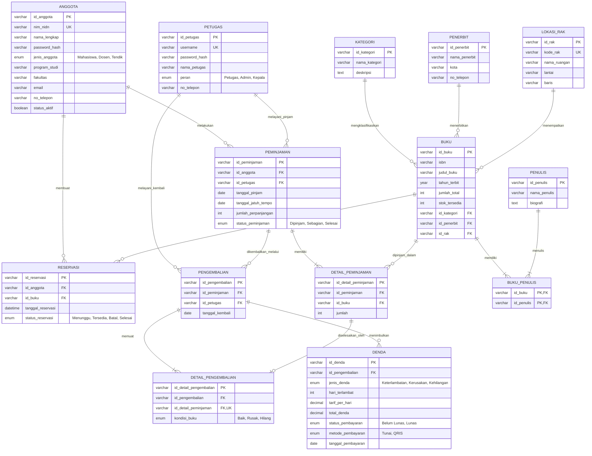
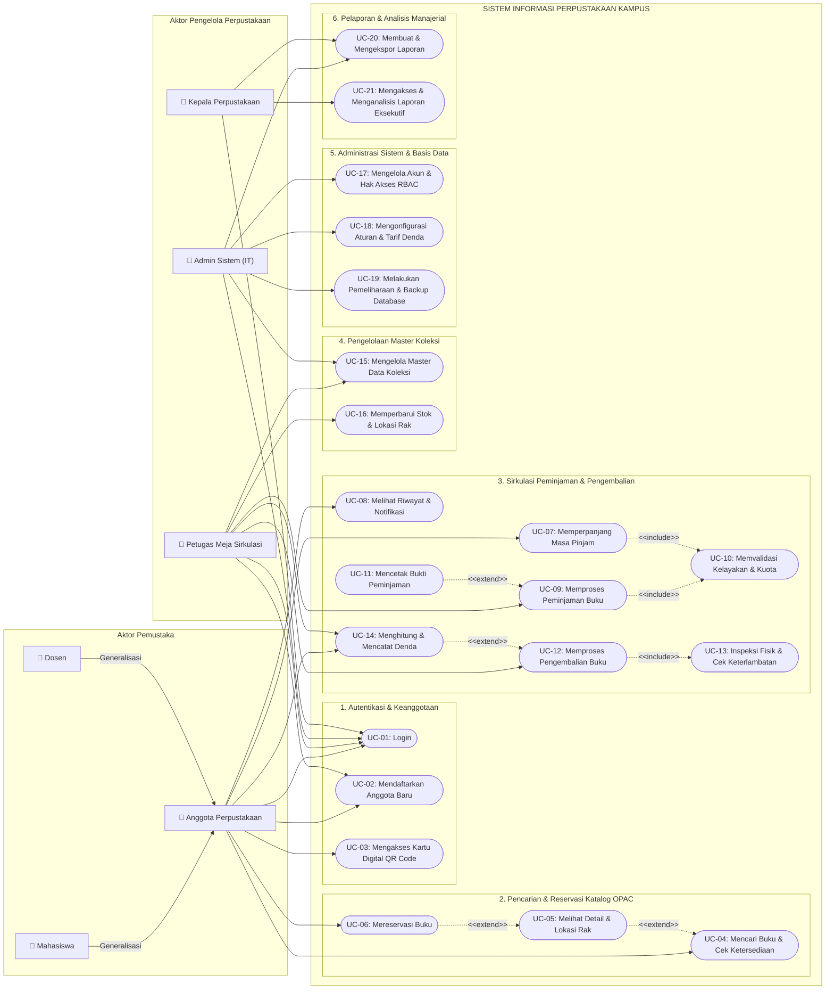

# DOKUMENTASI TEKNIS: FLOWCHART & ENTITY RELATIONSHIP DIAGRAM (ERD)
## SISTEM INFORMASI PERPUSTAKAAN KAMPUS
**Disusun untuk:** Laporan Tugas 2 Mata Kuliah Sistem Informasi  
**Kelompok 4:**
1. Aldiman (250320574)
2. Alfan Nur Fadzilah (250320575)
3. Aulia Zahra Fatmawati (250320580)
4. Ayu Ida Nuraini (250320588)  
**Program Studi:** Sains Data - Universitas Putra Bangsa (2026)

---

## DAFTAR ISI
1. [Petunjuk Penggunaan File dalam Folder](#petunjuk-penggunaan-file-dalam-folder)
2. [Flowchart 1: Alur Utama Sistem (Cross-Functional Swimlane)](#flowchart-1-alur-utama-sistem-cross-functional-swimlane)
3. [Flowchart 2: Sub-Proses Pendaftaran Anggota Baru](#flowchart-2-sub-proses-pendaftaran-anggota-baru)
4. [Flowchart 3: Sub-Proses Pencarian & Pengecekan Ketersediaan Buku](#flowchart-3-sub-proses-pencarian--pengecekan-ketersediaan-buku)
5. [Flowchart 4: Sub-Proses Transaksi Peminjaman Buku](#flowchart-4-sub-proses-transaksi-peminjaman-buku)
6. [Flowchart 5: Sub-Proses Transaksi Pengembalian Buku & Perhitungan Denda](#flowchart-5-sub-proses-transaksi-pengembalian-buku--perhitungan-denda)
7. [Flowchart 6: Sub-Proses Pelaporan & Pengambilan Keputusan](#flowchart-6-sub-proses-pelaporan--pengambilan-keputusan)
8. [Entity Relationship Diagram (ERD) Basis Data Relasional](#entity-relationship-diagram-erd-basis-data-relasional)
9. [Kamus Data & Struktur Tabel](#kamus-data--struktur-tabel)
10. [Matriks Peran dan Hak Akses (Role-Based Access Control / CRUD)](#matriks-peran-dan-hak-akses-role-based-access-control--crud)
11. [Use Case Diagram & Spesifikasi Fungsional](#use-case-diagram--spesifikasi-fungsional)
12. [Flowchart Berdasarkan Peran Pengguna (Role-Based Workflows)](#flowchart-berdasarkan-peran-pengguna-role-based-workflows)
    * [12.1 Flowchart Admin Sistem (Superadmin / IT)](#121-flowchart-admin-sistem-superadmin--it)
    * [12.2 Flowchart Kepala Perpustakaan (Eksekutif & Strategis)](#122-flowchart-kepala-perpustakaan-eksekutif--strategis)
    * [12.3 Flowchart Pengguna (Mahasiswa / Dosen / Pemustaka)](#123-flowchart-pengguna-mahasiswa--dosen--pemustaka)
    * [12.4 Flowchart Petugas Meja Sirkulasi & Pengolahan Koleksi](#124-flowchart-petugas-meja-sirkulasi--pengolahan-koleksi)

---

## PETUNJUK PENGGUNAAN FILE DALAM FOLDER
Di dalam folder `Diagram_dan_ERD_Perpustakaan` ini terdapat beberapa berkas:
1. `Lihat_Semua_Diagram.html`: **(Sangat Direkomendasikan)** Buka berkas ini dengan mengklik dua kali (*double click*). Berkas akan terbuka di Google Chrome / Microsoft Edge dengan tampilan visual grafis warna yang rapi, interaktif, dan beresolusi tinggi. Anda dapat langsung mengklik kanan dan memilih **Copy Image** atau menggunakan **Snipping Tool** untuk menempelkan diagram ke Microsoft Word atau PowerPoint.
2. `01_...` hingga `07_...mmd`: Berkas kode sumber diagram standar Mermaid. Kode ini dapat Anda salin dan tempelkan ke situs pembuat diagram seperti [Draw.io](https://app.diagrams.net) (menu *Arrange > Insert > Advanced > Mermaid*) atau [Mermaid Live Editor](https://mermaid.live).
3. `DOKUMENTASI_FLOWCHART_DAN_ERD.md`: Berkas dokumentasi teks lengkap beserta penjelasan naratif langkah demi langkah untuk setiap proses bisnis.

---

## FLOWCHART 1: ALUR UTAMA SISTEM (CROSS-FUNCTIONAL SWIMLANE)

### Tujuan:
Menggambarkan interaksi menyeluruh lintas 4 aktor utama sistem: Pengguna (Mahasiswa/Dosen), Petugas Meja Sirkulasi, Admin Sistem (IT), serta Kepala Perpustakaan. Swimlane ini difokuskan murni pada 4 aktor/peran pengguna, di mana sistem informasi bertindak sebagai platform/media kerja interaksi para aktor (bukan sebagai aktor swimlane tersendiri).

### Kode Mermaid:
```mermaid
flowchart TD
    %% ================================================================
    %% FLOWCHART UTAMA SISTEM INFORMASI PERPUSTAKAAN KAMPUS
    %% Model Cross-Functional Swimlane: 4 Aktor Utama (Tanpa Sistem/Basis Data)
    %% ================================================================

    subgraph S_Anggota["👤 Pengguna (Mahasiswa / Dosen)"]
        START(["Mulai"])
        REG_ANGGOTA["Pendaftaran Anggota Baru\n(isi formulir, input NIM/NIDN, & lengkapi data)"]
        LOGIN["Login ke Aplikasi Mobile /\nPortal Web OPAC"]
        CEK_LOGIN{"Login Berhasil?"}
        CARI_KATALOG["Pencarian Buku di Katalog\n(OPAC / Aplikasi Mobile)"]
        CEK_BUKU{"Buku Tersedia?"}
        PILIH_TINDAK{"Pilihan Pemustaka?"}
        RESERVASI["Reservasi Buku via Aplikasi\n(Notifikasi saat tersedia)"]
        AMBIL_BUKU["Ambil Buku Fisik di Rak &\nBawa Kartu QR ke Sirkulasi"]
        TERIMA_PINJAM["Terima Buku Fisik &\nBukti Transaksi Peminjaman"]
        PAKAI_BUKU["Gunakan Koleksi Buku Sesuai\nMasa Berlaku Peminjaman"]
        CEK_PERPANJANG_USER{"Perpanjang\nMasa Pinjam?"}
        KEMBALIKAN_BUKU["Bawa & Kembalikan Buku Fisik\nke Meja Sirkulasi Perpustakaan"]
        BAYAR_DENDA["Bayar Tagihan Denda\n(Tunai / QRIS)"]
        TERIMA_BUKTI_KEMBALI["Terima Bukti Pengembalian\n& Status Bebas Tanggungan"]
        END_NODE(["Selesai"])
    end

    subgraph S_Petugas["🧑‍💼 Petugas Meja Sirkulasi"]
        VERIF_ANGGOTA["Verifikasi Data Anggota &\nPengecekan Status Kampus"]
        CEK_VALID_REG{"Data Valid &\nBelum Terdaftar?"}
        TOLAK_REG["Tolak Pendaftaran &\nInformasikan Alasan Revisi"]
        GEN_AKUN["Generate ID Anggota, Akun Login\n& Kartu Digital QR Code"]
        SCAN_PINJAM["Scan QR Kartu Anggota &\nBarcode Koleksi Buku"]
        CEK_STATUS{"Validasi Kelayakan:\nStatus Aktif, Bebas Denda,\n& Kuota Pinjam Cukup?"}
        TOLAK_PINJAM["Transaksi Pinjam Ditolak:\nInformasikan Alasan ke Anggota"]
        PROSES_PINJAM["Proses Peminjaman di Sistem:\nKurangi Stok Koleksi &\nTetapkan Jatuh Tempo (+7 Hari)"]
        CETAK_BUKTI["Cetak Bukti Peminjaman /\nKirim e-Receipt ke Aplikasi"]
        CEK_PERPANJANG_PETUGAS{"Layak Perpanjang?\n(Tidak direservasi orang\n& belum melebihi limit)"}
        TOLAK_PERPANJANG["Perpanjangan Ditolak:\nInfokan Buku Wajib Kembali"]
        SETUJUI_PERPANJANG["Perpanjangan Disetujui:\nPerbarui Tanggal Jatuh Tempo"]
        TERIMA_KEMBALI["Terima Buku Pengembalian &\nScan Barcode Koleksi"]
        CEK_KONDISI{"Kondisi Fisik\nBuku?"}
        DENDA_RUSAK["Hitung Denda Ganti Rugi /\nProses Penggantian Buku Fisik"]
        CEK_TERLAMBAT{"Terlambat\nKembali?"}
        HITUNG_DENDA["Hitung Denda Keterlambatan\n(Hari Terlambat × Tarif Denda)"]
        CATAT_DENDA["Konfirmasi Pembayaran\nDenda Lunas di Sistem"]
        UPDATE_BUKU["Perbarui Status Koleksi 'Tersedia'\n& Kembalikan Buku Fisik ke Rak"]
    end

    subgraph S_Admin["⚙️ Admin Sistem (IT)"]
        ADM_MASTER[/"Input Data Master Perpustakaan\n(koleksi buku, kategori, rak,\npenulis, penerbit, & petugas)"/]
        ADM_AKUN["Kelola Akun Pengguna &\nHak Akses Sistem (RBAC)"]
        ADM_CONFIG["Konfigurasi Pengaturan Sistem:\nKuota Pinjam, Batas Waktu (+7 Hari),\n& Tarif Denda"]
        ADM_LAPORAN["Kelola, Rekapitulasi Transaksi,\nStatistik Koleksi & Denda\n(Hasilkan Laporan Otomatis)"]
    end

    subgraph S_Kepala["👔 Kepala Perpustakaan"]
        KEPALA_TINJAU["Akses & Tinjau Laporan Berkala\nTransaksi, Koleksi, & Denda"]
        KEPALA_KEPUTUSAN[/"Pengambilan Keputusan Manajerial:\n• Pengadaan Koleksi Buku Baru\n• Evaluasi Buku Jarang Dipinjam\n• Tindak Lanjut Keterlambatan\n• Perencanaan Anggaran Perpustakaan"/]
    end

    %% Internal Admin Flow
    ADM_MASTER -.-> ADM_AKUN -.-> ADM_CONFIG

    %% Registrasi & Akun
    START --> REG_ANGGOTA
    REG_ANGGOTA --> VERIF_ANGGOTA
    VERIF_ANGGOTA --> CEK_VALID_REG
    CEK_VALID_REG -- "Tidak" --> TOLAK_REG
    TOLAK_REG -. "Revisi Data" .-> REG_ANGGOTA
    CEK_VALID_REG -- "Ya" --> GEN_AKUN
    GEN_AKUN --> LOGIN

    %% Login & Katalog
    LOGIN --> CEK_LOGIN
    CEK_LOGIN -- "Tidak" --> LOGIN
    CEK_LOGIN -- "Ya" --> CARI_KATALOG
    CARI_KATALOG --> CEK_BUKU

    %% Ketersediaan Buku
    CEK_BUKU -- "Tidak Tersedia" --> PILIH_TINDAK
    PILIH_TINDAK -- "Reservasi" --> RESERVASI
    RESERVASI -. "Antre Notifikasi" .-> CARI_KATALOG
    PILIH_TINDAK -- "Cari Lain" -.-> CARI_KATALOG
    CEK_BUKU -- "Tersedia" --> AMBIL_BUKU

    %% Peminjaman
    AMBIL_BUKU --> SCAN_PINJAM
    SCAN_PINJAM --> CEK_STATUS
    CEK_STATUS -- "Tidak Lolos" --> TOLAK_PINJAM
    TOLAK_PINJAM -. "Batal / Cari Lain" .-> CARI_KATALOG
    CEK_STATUS -- "Lolos" --> PROSES_PINJAM
    PROSES_PINJAM --> CETAK_BUKTI
    CETAK_BUKTI --> TERIMA_PINJAM
    TERIMA_PINJAM --> PAKAI_BUKU

    %% Perpanjangan Masa Pinjam
    PAKAI_BUKU --> CEK_PERPANJANG_USER
    CEK_PERPANJANG_USER -- "Ya" --> CEK_PERPANJANG_PETUGAS
    CEK_PERPANJANG_PETUGAS -- "Tidak" --> TOLAK_PERPANJANG
    TOLAK_PERPANJANG -. "Wajib Kembali" .-> KEMBALIKAN_BUKU
    CEK_PERPANJANG_PETUGAS -- "Ya" --> SETUJUI_PERPANJANG
    SETUJUI_PERPANJANG -. "Masa Pinjam Diperbarui" .-> PAKAI_BUKU
    CEK_PERPANJANG_USER -- "Tidak" --> KEMBALIKAN_BUKU

    %% Pengembalian & Denda
    KEMBALIKAN_BUKU --> TERIMA_KEMBALI
    TERIMA_KEMBALI --> CEK_KONDISI
    CEK_KONDISI -- "Rusak / Hilang" --> DENDA_RUSAK
    DENDA_RUSAK --> CEK_TERLAMBAT
    CEK_KONDISI -- "Baik" --> CEK_TERLAMBAT
    CEK_TERLAMBAT -- "Ya (Terlambat)" --> HITUNG_DENDA
    HITUNG_DENDA -- "Tagihan Denda" --> BAYAR_DENDA
    BAYAR_DENDA --> CATAT_DENDA
    CATAT_DENDA --> UPDATE_BUKU
    CEK_TERLAMBAT -- "Tidak" --> UPDATE_BUKU

    %% Selesai Pemustaka
    UPDATE_BUKU --> TERIMA_BUKTI_KEMBALI
    TERIMA_BUKTI_KEMBALI --> END_NODE

    %% Pelaporan & Keputusan Manajemen
    UPDATE_BUKU -- "Akumulasi Data" --> ADM_LAPORAN
    ADM_LAPORAN -- "Serahkan Laporan" --> KEPALA_TINJAU
    KEPALA_TINJAU --> KEPALA_KEPUTUSAN
```

### Narasi Penjelasan Alur:
1. **Tahap Pencarian Mandiri:** Mahasiswa atau dosen membuka katalog daring (OPAC) atau aplikasi ponsel untuk mencari buku dan mengecek ketersediaannya di rak.
2. **Tahap Sirkulasi Peminjaman:** Pemustaka mengambil buku fisik di rak lalu membawanya beserta identitas (KTM / QR Code aplikasi) ke meja sirkulasi. Petugas memindai kartu anggota dan barcode buku.
3. **Validasi & Eksekusi Peminjaman:** Sistem memeriksa database berdasarkan aturan yang dikonfigurasi Admin (status keaktifan akun, bebas tunggakan denda, dan batas maksimal kuota pinjaman). Jika valid, sistem mengurangi stok buku, mencatat transaksi, dan petugas mencetak bukti peminjaman.
4. **Tahap Sirkulasi Pengembalian:** Saat pengembalian, petugas memindai kembali buku dan memeriksa keutuhan fisiknya. Sistem menghitung ada/tidaknya keterlambatan secara otomatis berdasarkan formula durasi dan tarif denda harian yang diatur Admin.
5. **Penyelesaian Pengembalian:** Jika ada denda, pengguna membayar dan dikonfirmasi petugas. Sistem mengembalikan status buku menjadi "Tersedia", memperbarui riwayat transaksi, menerbitkan bukti pengembalian, dan petugas merestok buku ke rak koleksi.
6. **Peran Admin Sistem (IT):**
   * **Mengelola Akun Pengguna:** Melakukan registrasi, verifikasi, aktivasi, dan pembaruan data pengguna (Mahasiswa, Dosen, dan Petugas).
   * **Mengelola Hak Akses (RBAC):** Menetapkan wewenang peran (*role-based access control*) untuk tiap modul sistem agar keamanan data terjamin.
   * **Konfigurasi Pengaturan Sistem:** Mengatur parameter kebijakan operasional seperti durasi peminjaman standar, kuota maksimal peminjaman, serta tarif denda per hari keterlambatan.
   * **Manajemen Basis Data:** Menjalankan pemeliharaan integritas, optimasi indeks, serta pencadangan (*backup*) data secara terjadwal untuk menjamin ketersediaan (*high availability*) data.
   * **Pengelolaan Laporan:** Mengolah data agregat transaksi dan koleksi dari sistem menjadi dokumen laporan resmi yang siap dipresentasikan.
7. **Pengambilan Keputusan Manajerial:** Admin menyerahkan laporan tervalidasi kepada Kepala Perpustakaan untuk dianalisis guna pengambilan keputusan strategis (pengadaan buku baru, evaluasi penyiangan koleksi rusak, dan penyesuaian anggaran/kebijakan). Keputusan ini kemudian didisposisikan kembali ke Admin Sistem untuk penyesuaian parameter pengaturan sistem.

---

## FLOWCHART 2: SUB-PROSES PENDAFTARAN ANGGOTA BARU

### Tujuan:
Mengatur alur registrasi civitas akademika baru dan penerbitan kredensial akses perpustakaan.

### Kode Mermaid:


### Logika & Aturan Bisnis:
* Hanya civitas akademika dengan NIM/NIDN valid yang dapat mendaftar.
* Mencegah akun ganda dengan validasi *unique key* NIM/NIDN.
* Kartu anggota diterbitkan dalam bentuk QR Code digital pada aplikasi mobile untuk efisiensi biaya cetak kartu plastik.

---

## FLOWCHART 3: SUB-PROSES PENCARIAN & PENGECEKAN KETERSEDIAAN BUKU

### Tujuan:
Memfasilitasi penelusuran buku mandiri oleh pemustaka melalui web OPAC atau aplikasi mobile.

### Kode Mermaid:


---

## FLOWCHART 4: SUB-PROSES TRANSAKSI PEMINJAMAN BUKU

### Tujuan:
Memverifikasi kelayakan pemustaka, merekam transaksi sirkulasi, dan memperbarui stok inventaris.

### Kode Mermaid:


---

## FLOWCHART 5: SUB-PROSES TRANSAKSI PENGEMBALIAN BUKU & PERHITUNGAN DENDA

### Tujuan:
Menangani pengembalian fisik buku, verifikasi kondisi, perhitungan denda otomatis, dan restock rak.

### Kode Mermaid:


---

## FLOWCHART 6: SUB-PROSES PELAPORAN & PENGAMBILAN KEPUTUSAN

### Tujuan:
Menghubungkan data transaksi operasional harian menjadi bahan evaluasi strategis Kepala Perpustakaan.

### Kode Mermaid:


---

## ENTITY RELATIONSHIP DIAGRAM (ERD) BASIS DATA RELASIONAL



---

## KAMUS DATA & STRUKTUR TABEL LENGKAP

### 1. Entitas ANGGOTA
* `id_anggota` (VARCHAR(15), Primary Key): Identifikator unik sistem (contoh: `AGT-2026-0001`).
* `nim_nidn` (VARCHAR(20), Unique Key): Nomor Induk Mahasiswa atau Dosen/Tendik.
* `nama_lengkap` (VARCHAR(100)): Nama lengkap civitas akademika.
* `jenis_anggota` (ENUM('Mahasiswa', 'Dosen', 'Tendik')): Klasifikasi status pemustaka.
* `program_studi` (VARCHAR(50)): Program studi anggota (misal: Sistem Informasi, Sains Data).
* `fakultas` (VARCHAR(50)): Fakultas penaung.
* `email` (VARCHAR(100)): Alamat surel aktif untuk notifikasi jatuh tempo.
* `no_telepon` (VARCHAR(15)): Nomor telepon/WhatsApp aktif.
* `status_aktif` (BOOLEAN): Status keaktifan (True = Aktif, False = Nonaktif/Lulus).

### 2. Entitas PETUGAS
* `id_petugas` (VARCHAR(15), Primary Key): Identifikator unik staf (contoh: `STF-001`).
* `username` (VARCHAR(30), Unique Key): Nama pengguna login staf.
* `password_hash` (VARCHAR(255)): Hash kata sandi terenkripsi (BCrypt).
* `nama_petugas` (VARCHAR(100)): Nama lengkap staf perpustakaan.
* `peran` (ENUM('Petugas', 'Admin')): Tingkat privilese otorisasi.
* `no_telepon` (VARCHAR(15)): Nomor kontak operasional petugas.

### 3. Entitas KATEGORI
* `id_kategori` (VARCHAR(10), Primary Key): Kode klasifikasi buku (contoh: `KAT-001`).
* `nama_kategori` (VARCHAR(50)): Nama kategori bidang keilmuan (misal: Ilmu Komputer, Bisnis).
* `deskripsi` (TEXT): Rincian cakupan materi kategori.

### 4. Entitas PENERBIT
* `id_penerbit` (VARCHAR(10), Primary Key): Kode penerbit (contoh: `PUB-001`).
* `nama_penerbit` (VARCHAR(100)): Nama perusahaan penerbitan buku.
* `kota` (VARCHAR(50)): Kota asal kantor penerbit.
* `no_telepon` (VARCHAR(20)): Kontak komunikasi penerbit.

### 5. Entitas PENULIS
* `id_penulis` (VARCHAR(10), Primary Key): Kode pengarang (contoh: `AUT-001`).
* `nama_penulis` (VARCHAR(100)): Nama lengkap penulis atau kontributor buku.
* `biografi` (TEXT): Catatan profil singkat penulis.

### 6. Entitas LOKASI_RAK
* `id_rak` (VARCHAR(10), Primary Key): Kode internal rak perpustakaan.
* `kode_rak` (VARCHAR(20), Unique Key): Label fisik rak (contoh: `RAK-CS-01`).
* `nama_ruangan` (VARCHAR(50)): Nama ruangan/hall lantai baca.
* `lantai` (VARCHAR(20)): Penunjukan lantai fisik (misal: 'Lantai 2').
* `baris` (VARCHAR(20)): Penunjukan lajur/lorong rak (misal: 'Baris A').

### 7. Entitas BUKU
* `id_buku` (VARCHAR(15), Primary Key): Identifikator unik katalog judul (contoh: `BK-000123`).
* `isbn` (VARCHAR(20)): Nomor standar buku internasional (ISBN-13).
* `judul_buku` (VARCHAR(200)): Judul lengkap buku literatur.
* `tahun_terbit` (YEAR): Tahun rilis penerbitan.
* `jumlah_total` (INT): Total eksemplar keseluruhan yang dimiliki perpustakaan.
* `stok_tersedia` (INT): Jumlah eksemplar yang sedang berada di rak dan siap dipinjam (*Materialized Cache Attribute*).
* `id_kategori` (VARCHAR(10), Foreign Key ke KATEGORI).
* `id_penerbit` (VARCHAR(10), Foreign Key ke PENERBIT).
* `id_rak` (VARCHAR(10), Foreign Key ke LOKASI_RAK).

### 8. Entitas BUKU_PENULIS (Junction Table M:N)
* `id_buku` (VARCHAR(15), Primary Key & Foreign Key ke BUKU).
* `id_penulis` (VARCHAR(10), Primary Key & Foreign Key ke PENULIS).
* *Catatan Kunci:* Kolom `(id_buku, id_penulis)` membentuk **Composite Primary Key** untuk mencegah pencatatan relasi ganda penulis yang sama pada satu judul buku.

### 9. Entitas PEMINJAMAN
* `id_peminjaman` (VARCHAR(20), Primary Key): Nomor transaksi sirkulasi (contoh: `TRX-P-20261104-001`).
* `id_anggota` (VARCHAR(15), Foreign Key ke ANGGOTA).
* `id_petugas` (VARCHAR(15), Foreign Key ke PETUGAS).
* `tanggal_pinjam` (DATE): Waktu transaksi peminjaman diproses di meja sirkulasi.
* `tanggal_jatuh_tempo` (DATE): Batas akhir waktu pengembalian buku (+7 hari kalender).
* `status_peminjaman` (ENUM('Dipinjam', 'Sebagian', 'Selesai')): Status penyelesaian transaksi sirkulasi.

### 10. Entitas DETAIL_PEMINJAMAN
* `id_detail_peminjaman` (VARCHAR(20), Primary Key): Kode unik baris item pinjaman.
* `id_peminjaman` (VARCHAR(20), Foreign Key ke PEMINJAMAN).
* `id_buku` (VARCHAR(15), Foreign Key ke BUKU).
* `jumlah` (INT): Kuantitas eksemplar yang dipinjam.
* *Constraint Integritas:* `UNIQUE (id_peminjaman, id_buku)` diterapkan agar judul buku yang sama tidak terdaftar berulang kali dalam satu nomor transaksi pinjam.

### 11. Entitas PENGEMBALIAN
* `id_pengembalian` (VARCHAR(20), Primary Key): Nomor sesi transaksi pengembalian (contoh: `TRX-K-20261111-001`).
* `id_peminjaman` (VARCHAR(20), Foreign Key ke PEMINJAMAN): Mengaitkan sesi pengembalian dengan peminjaman induk. Karena mendukung pengembalian bertahap/parsial, satu nomor peminjaman dapat memiliki lebih dari satu transaksi pengembalian (1 : N).
* `id_petugas` (VARCHAR(15), Foreign Key ke PETUGAS): Petugas yang menerima penyerahan buku fisik.
* `tanggal_kembali` (DATE): Tanggal aktual buku diserahkan ke meja sirkulasi.

### 12. Entitas DETAIL_PENGEMBALIAN
* `id_detail_pengembalian` (VARCHAR(20), Primary Key): Kode unik baris item pengembalian.
* `id_pengembalian` (VARCHAR(20), Foreign Key ke PENGEMBALIAN).
* `id_detail_peminjaman` (VARCHAR(20), Foreign Key ke DETAIL_PEMINJAMAN, Unique Key): Constraint `UNIQUE` menjamin setiap item peminjaman buku hanya dapat dikembalikan tepat satu kali (mencegah *double-return*).
* `kondisi_buku` (ENUM('Baik', 'Rusak', 'Hilang')): Hasil inspeksi fisik spesifik untuk masing-masing buku yang dikembalikan saat sesi transaksi tersebut.

### 13. Entitas DENDA
* `id_denda` (VARCHAR(20), Primary Key): Nomor resi tagihan denda sirkulasi (contoh: `FNE-20261111-001`).
* `id_pengembalian` (VARCHAR(20), Foreign Key ke PENGEMBALIAN).
* `jenis_denda` (ENUM('Keterlambatan', 'Kerusakan', 'Kehilangan')): Klasifikasi pelanggaran yang mendasari penagihan sanksi finansial.
* `hari_terlambat` (INT): Total hari keterlambatan (0 jika denda akibat kerusakan/kehilangan fisik tanpa keterlambatan).
* `tarif_per_hari` (DECIMAL(10,2)): Besaran tarif harian saat transaksi berlangsung (*snapshot* tarif).
* `total_denda` (DECIMAL(10,2)): Total nominal tagihan yang wajib dilunasi (*snapshot* resmi tagihan).
* `status_pembayaran` (ENUM('Belum Lunas', 'Lunas')): Status pembayaran denda.
* `tanggal_pembayaran` (DATE): Tanggal pelunasan denda oleh pemustaka.

---

## CATATAN ARSITEKTUR & PENYELESAIAN MASALAH DESAIN BASIS DATA

Berikut adalah dokumentasi keputusan desain dan justifikasi teknis perbaikan ERD:

### 1. Solusi Masalah Relasi Peminjaman - Pengembalian (1:N vs 1:1) & Pengembalian Parsial
* **Masalah Awal:** Pada rancangan awal, relasi `PEMINJAMAN` ke `PENGEMBALIAN` diasumsikan 1:1 murni tanpa constraint `UK`, dan kolom `kondisi_buku` diletakkan di header tabel `PENGEMBALIAN`. Hal ini menyebabkan sistem tidak mampu mencatat kondisi fisik yang berbeda antarbuku dalam 1 transaksi (misal: Buku A Baik, Buku B Rusak), serta tidak mendukung pengembalian sebagian (misal: meminjam 3 buku, mengembalikan 2 buku terlebih dahulu di hari ke-5, lalu mengembalikan 1 buku sisanya di hari ke-8).
* **Solusi Arsitektur Terpilih (Enterprise Design - Solusi Lengkap):**
  1. Relasi diubah menjadi **`PEMINJAMAN (1) : (0..N) PENGEMBALIAN`**, di mana satu peminjaman dapat diselesaikan melalui satu atau beberapa sesi pengembalian bertahap.
  2. Dibuat entitas perantara **`DETAIL_PENGEMBALIAN`** yang menghubungkan `PENGEMBALIAN` dan `DETAIL_PEMINJAMAN`.
  3. Kolom `kondisi_buku` dipindahkan ke `DETAIL_PENGEMBALIAN` sehingga setiap fisik buku diperiksa secara independen.
  4. Kolom `id_detail_peminjaman` di `DETAIL_PENGEMBALIAN` diberi constraint `UNIQUE` (`FK, UK`), menjamin integritas data bahwa sebuah item buku yang sudah dipinjam tidak dapat dikembalikan dua kali.
* **Alternatif Solusi Sederhana (Jika Dibatasi Transaksi Tunggal):**
  Jika perpustakaan memiliki aturan operasional ketat bahwa seluruh buku wajib dikembalikan sekaligus dalam 1 kali penyerahan, maka relasi dapat dipertahankan `PEMINJAMAN (1) : (0..1) PENGEMBALIAN` dengan menambahkan constraint `UNIQUE` pada `PENGEMBALIAN.id_peminjaman`, dan memindahkan `kondisi_buku` ke dalam tabel `DETAIL_PEMINJAMAN`. Desain utama saat ini mengadopsi solusi lengkap karena jauh lebih fleksibel dan sesuai standar sistem sirkulasi modern.

### 2. Penetapan Composite Primary Key pada Entitas Bridge
* Entitas persimpangan (junction table) `BUKU_PENULIS` kini secara eksplisit menetapkan `(id_buku, id_penulis)` sebagai **Composite Primary Key** (`PK, FK`). Hal ini mencegah anomali relasi ganda (*duplicate relationship*) antara buku dan pengarang yang sama.
* Entitas `DETAIL_PEMINJAMAN` juga dilengkapi aturan integritas komposit `UNIQUE (id_peminjaman, id_buku)` agar judul buku yang sama tidak terinput ganda dalam satu slip pinjam.

### 3. Normalisasi Data & Justifikasi Denormalisasi Terkendali
* **Penghapusan Kolom Redundan:** Kolom boolean `terlambat` pada tabel `PENGEMBALIAN` dihapus karena merupakan atribut turunan murni (*derived attribute*) yang selalu dapat dihitung secara dinamis dari rumus `tanggal_kembali > tanggal_jatuh_tempo`.
* **Denormalisasi Finansial Historis (`DENDA.total_denda` & `DENDA.tarif_per_hari`):** Kolom ini sengaja dipertahankan sebagai denormalisasi yang disengaja (*Controlled Denormalization / Historical Immutability Pattern*). Di dunia nyata, kebijakan tarif denda dapat berubah sewaktu-waktu berdasarkan surat keputusan pimpinan. Nilai tagihan denda historis harus terkunci pada saat slip denda diterbitkan agar laporan keuangan masa lampau tidak berubah saat tarif master diperbarui.
* **Denormalisasi Caching Performa (`BUKU.stok_tersedia`):** Kolom ini dipertahankan sebagai *materialized counter* guna mempercepat respon pencarian katalog (OPAC) tanpa mengharuskan sistem menjalankan query agregasi `COUNT(*)` dari seluruh histori sirkulasi secara terus-menerus. Integritas nilai stok dijaga melalui *Database Trigger* `AFTER INSERT/UPDATE` pada transaksi sirkulasi.
* **Penyempurnaan `status_peminjaman`:** Menggunakan ENUM `'Dipinjam', 'Sebagian', 'Selesai'` untuk merefleksikan status sirkulasi secara akurat saat terjadi pengembalian bertahap.

### 4. Kelengkapan Spesifikasi ENUM & Skema Denda Multipelanggaran
* Seluruh tipe data ENUM kini memiliki definisi himpunan nilai eksplisit:
  * `jenis_anggota`: `'Mahasiswa', 'Dosen', 'Tendik'`
  * `peran`: `'Petugas', 'Admin'`
  * `status_peminjaman`: `'Dipinjam', 'Sebagian', 'Selesai'`
  * `kondisi_buku`: `'Baik', 'Rusak', 'Hilang'`
  * `jenis_denda`: `'Keterlambatan', 'Kerusakan', 'Kehilangan'`
  * `status_pembayaran`: `'Belum Lunas', 'Lunas'`
* Entitas `DENDA` kini memuat atribut `jenis_denda` sehingga penegakan sanksi tidak hanya mencakup keterlambatan hari, namun juga mencakup denda perbaikan buku rusak dan biaya penggantian buku hilang sesuai hasil inspeksi di meja sirkulasi.

### 5. Batasan Lingkup: Katalog Level Judul (*Title-Level*) vs Eksemplar Fisik
* **Asumsi Perancangan (Scope Assumption):** Dalam perancangan basis data ini, entitas `BUKU` merepresentasikan katalog pada level judul buku (*Title-Level Cataloging*) dengan agregasi stok kuantitas (`jumlah_total` & `stok_tersedia`). Pelacakan nomor registrasi eksemplar/barcode fisik individual (*Copy-Level Cataloging*) tidak dimodelkan ke tabel terpisah demi kesederhanaan lingkup proyek akademik. Penggantian buku rusak/hilang didefinisikan berdasarkan kuantitas pengurangan stok pada judul yang bersangkutan.

### 6. Atomisitas Atribut & Standarisasi Penamaan
* **Atomisitas Rak (1NF):** Atribut gabungan `baris_lantai` pada `LOKASI_RAK` telah dipecah menjadi dua atribut atomik terpisah: `lantai` (contoh: "Lantai 2") dan `baris` (contoh: "Baris A"), sehingga memenuhi kaidah Bentuk Normal Pertama (1NF).
* **Standarisasi Penamaan:** Atribut kontak yang sebelumnya tidak seragam (`kontak` vs `no_telepon`) telah distandardisasi menjadi `no_telepon` di seluruh entitas terkait (`ANGGOTA`, `PETUGAS`, dan `PENERBIT`).
* **Klasifikasi Kategori Buku (1:N):** Relasi `KATEGORI (1) : (N) BUKU` dipertahankan dengan asumsi standar perpustakaan akademik berbasis *Dewey Decimal Classification* (DDC), di mana setiap buku fisik hanya dialokasikan ke tepat satu penempatan nomor klasifikasi rak utama.

---

---

## MATRIKS PERAN DAN HAK AKSES (ROLE-BASED ACCESS CONTROL / CRUD)

| Entitas Data / Modul | Mahasiswa / Dosen | Petugas Meja Sirkulasi | Admin Sistem (IT) | Kepala Perpustakaan |
| :--- | :--- | :--- | :--- | :--- |
| **Data Anggota** | Read (Profil sendiri), Update (No Kontak) | Create, Read, Update | Create, Read, Update, Delete (Full) | Read |
| **Katalog Buku & Rak** | Read (Pencarian OPAC) | Read, Update Stok | Create, Read, Update, Delete (Full) | Read |
| **Transaksi Peminjaman** | Read (Riwayat sendiri) | Create, Read, Update | Create, Read, Update, Delete | Read |
| **Transaksi Pengembalian** | Read (Riwayat sendiri) | Create, Read, Update | Create, Read, Update, Delete | Read |
| **Data Denda** | Read (Tagihan sendiri) | Create, Read, Update (Konfirmasi Bayar) | Create, Read, Update, Delete | Read (Audit) |
| **Laporan & Rekapitulasi**| No Access | Read (Laporan Harian) | Generate, Export | Read, Analyze, Decision |

---

## USE CASE DIAGRAM & SPESIFIKASI FUNGSIONAL (REVISI STANDAR UML)

### 1. Tujuan:
Menggambarkan interaksi fungsional antara aktor pengguna dengan sistem informasi perpustakaan, mendefinisikan batasan sistem (*system boundary*), serta memperjelas relasi dependensi fungsional (`<<include>>` dan `<<extend>>`) sesuai kaidah standar pemodelan UML yang telah diselaraskan dengan arsitektur ERD dan batasan sistem.

### 2. Identifikasi Aktor Sistem:
1. **Anggota Perpustakaan (Aktor Generalisasi Pemustaka):** Pengguna layanan perpustakaan kampus yang mengakses OPAC dan aplikasi mobile untuk mencari katalog, melihat kartu digital QR Code, mereservasi koleksi, melakukan perpanjangan mandiri, melihat riwayat pinjaman, dan melihat/membayar tagihan denda. Aktor ini dispesifikasi melalui generalisasi:
   - **Mahasiswa:** Pemustaka tingkat sarjana/diploma.
   - **Dosen:** Tenaga pendidik dengan masa dan kuota pinjam proporsional.
2. **Petugas Meja Sirkulasi:** Staf operasional perpustakaan yang bertugas melayani verifikasi pendaftaran anggota baru, memproses transaksi peminjaman fisik buku, memproses pengembalian buku, melakukan inspeksi kondisi fisik koleksi, menghitung & mencatat pembayaran denda, mengelola katalog master koleksi, dan memperbarui ketersediaan stok buku di rak.
3. **Admin Sistem (IT):** Pengelola infrastruktur teknologi yang mengelola akun pengguna, mengonfigurasi hak akses berbasis peran (*Role-Based Access Control* / RBAC), mengonfigurasi aturan operasional perpustakaan (kuota pinjam, durasi, dan tarif denda), melakukan pemeliharaan & *backup* basis data berkala, serta membuat rekapitulasi laporan transaksi resmi.
4. **Kepala Perpustakaan:** Pimpinan manajerial yang mengakses, meninjau, dan menganalisis laporan eksekutif berkala untuk kebutuhan evaluasi strategis (pengadaan buku baru, evaluasi penyiangan koleksi usang/rusak, dan penyesuaian kebijakan perpustakaan).

---

### 3. Diagram Use Case (Mermaid):


---

### 4. Matriks Rincian Use Case (21 Use Case Hasil Revisi):

| Kode | Use Case | Aktor Utama | Tipe Relasi / Catatan |
|---|---|---|---|
| **UC-01** | Login | Anggota, Petugas, Admin, Kepala | Autentikasi multi-peran ke sistem |
| **UC-02** | Mendaftarkan Anggota Baru | Petugas Meja Sirkulasi | Verifikasi dan pembuatan kartu anggota baru |
| **UC-03** | Mengakses Kartu Digital QR Code | Anggota Perpustakaan | Tampilan barcode/QR untuk transaksi meja sirkulasi |
| **UC-04** | Mencari Buku & Cek Ketersediaan | Anggota Perpustakaan | OPAC pencarian judul, pengarang, dan stok |
| **UC-05** | Melihat Detail & Lokasi Rak | Anggota Perpustakaan | `<<extend>>` UC-04 (Opsional saat melihat detail buku) |
| **UC-06** | Mereservasi Buku | Anggota Perpustakaan | `<<extend>>` UC-05 (Dieksekusi jika stok sedang kosong) |
| **UC-07** | Memperpanjang Masa Pinjam | Anggota Perpustakaan | `<<include>>` UC-10 (Wajib lolos validasi kelayakan) |
| **UC-08** | Melihat Riwayat & Notifikasi | Anggota Perpustakaan | Pemantauan koleksi yang dipinjam dan riwayat |
| **UC-09** | Memproses Peminjaman Buku | Petugas Meja Sirkulasi | `<<include>>` UC-10 (Wajib lolos validasi kuota) |
| **UC-10** | Memvalidasi Kelayakan & Kuota | *Included Use Case* | Disertakan wajib oleh UC-07 dan UC-09 |
| **UC-11** | Mencetak Bukti Peminjaman | *Extending Use Case* | `<<extend>>` UC-09 (Opsional pencetakan fisik/digital) |
| **UC-12** | Memproses Pengembalian Buku | Petugas Meja Sirkulasi | `<<include>>` UC-13 (Wajib inspeksi fisik buku) |
| **UC-13** | Inspeksi Fisik & Cek Keterlambatan | *Included Use Case* | Disertakan wajib oleh UC-12 |
| **UC-14** | Menghitung & Mencatat Denda | Petugas Meja Sirkulasi, Anggota | `<<extend>>` UC-12 (Dieksekusi bila terlambat/rusak/hilang) |
| **UC-15** | Mengelola Master Data Koleksi | Petugas Meja Sirkulasi | CRUD katalog buku, kategori, dan penerbit |
| **UC-16** | Memperbarui Stok & Lokasi Rak | Petugas Meja Sirkulasi | Pembaruan ketersediaan buku dan penempatan rak |
| **UC-17** | Mengelola Akun & Hak Akses (RBAC) | Admin Sistem (IT) | Konfigurasi akun pengguna dan privilese modul |
| **UC-18** | Mengonfigurasi Aturan & Tarif Denda | Admin Sistem (IT) | Pengaturan parameter kuota, durasi, dan tarif denda |
| **UC-19** | Melakukan Pemeliharaan & Backup Database | Admin Sistem (IT) | Manajemen basis data, indeks, dan cadangan data |
| **UC-20** | Membuat & Mengekspor Laporan | Admin Sistem (IT), Kepala | Penarikan data agregat sirkulasi ke format PDF/Excel |
| **UC-21** | Mengakses & Menganalisis Laporan Eksekutif | Kepala Perpustakaan | Evaluasi metrik kinerja sirkulasi dan literasi |

> **Catatan:** Use Case non-sistem *"Pengambilan Keputusan Strategis"* telah **dihapus** karena merupakan aktivitas pertimbangan manusia murni di luar fungsi aplikasi perangkat lunak.

---

### 5. Matriks Aturan Relasi Include & Extend:

| Use Case Asal (Panah Keluar) | Stereotip | Use Case Tujuan (Base / Target) | Penjelasan Logis & Kondisi |
|---|---|---|---|
| **Memproses Peminjaman Buku (UC-09)** | `<<include>>` | **Memvalidasi Kelayakan & Kuota (UC-10)** | Selalu dijalankan untuk memastikan akun aktif, bebas denda, dan kuota $\le 3$ buku. |
| **Memperpanjang Masa Pinjam (UC-07)** | `<<include>>` | **Memvalidasi Kelayakan & Kuota (UC-10)** | Selalu dijalankan agar perpanjangan tidak dapat dilakukan jika ada denda tertunggak atau limit terlampaui. |
| **Memproses Pengembalian Buku (UC-12)** | `<<include>>` | **Inspeksi Fisik & Cek Keterlambatan (UC-13)** | Selalu dijalankan untuk memeriksa integritas fisik dan tanggal penyerahan buku. |
| **Mencetak Bukti Peminjaman (UC-11)** | `<<extend>>` | **Memproses Peminjaman Buku (UC-09)** | Opsional: hanya dieksekusi bila anggota meminta struk cetak fisik / konfirmasi cetak. |
| **Menghitung & Mencatat Denda (UC-14)** | `<<extend>>` | **Memproses Pengembalian Buku (UC-12)** | Kondisional: hanya dipicu jika tanggal kembali melebihi jatuh tempo atau fisik buku rusak/hilang. |
| **Melihat Detail & Lokasi Rak (UC-05)** | `<<extend>>` | **Mencari Buku & Cek Ketersediaan (UC-04)** | Opsional: pemustaka dapat memilih melihat detail lokasi rak dari daftar hasil pencarian. |
| **Mereservasi Buku (UC-06)** | `<<extend>>` | **Melihat Detail & Lokasi Rak (UC-05)** | Kondisional: tombol reservasi hanya aktif apabila stok fisik buku bernilai 0 (`stok_tersedia = 0`). |

---

### 6. Spesifikasi Naratif Use Case Utama (Hasil Revisi):

#### Use Case UC-09: Memproses Peminjaman Buku
* **Aktor Primer:** Petugas Meja Sirkulasi.
* **Aktor Sekunder:** Anggota Perpustakaan (Mahasiswa / Dosen).
* **Pre-condition:** Petugas telah berhasil login ke sistem meja sirkulasi; Anggota telah membawa buku fisik dan menunjukkan kartu digital QR Code.
* **Post-condition:** Transaksi peminjaman tersimpan di tabel `PEMINJAMAN` dan `DETAIL_PEMINJAMAN`, stok buku berkurang, dan bukti transaksi diterbitkan.
* **Main Flow:**
  1. Petugas memindai QR Code kartu anggota pemustaka.
  2. Sistem menjalankan sub-alur wajib `<<include>> UC-10: Memvalidasi Kelayakan & Kuota` (memverifikasi status keaktifan akun, ketiadaan tunggakan denda, dan kuota pinjam belum melebihi batas).
  3. Petugas memindai barcode buku fisik yang dipinjam.
  4. Sistem membuat rekaman transaksi peminjaman, mencatat tanggal pinjam, dan menghitung otomatis tanggal jatuh tempo (+7 hari kalender).
  5. Sistem mengurangi atribut `stok_tersedia` pada katalog buku.
  6. Sistem menjalankan perluasan opsional `<<extend>> UC-11: Mencetak Bukti Peminjaman` untuk mencetak struk fisik / e-receipt.
  7. Petugas menyerahkan buku fisik kepada pemustaka dan transaksi selesai.
* **Alternative Flow:**
  * Bila validasi kelayakan gagal (akun nonaktif, ada denda tertunggak, atau kuota penuh), sistem menolak transaksi dan menampilkan notifikasi alasan penolakan pada monitor petugas.

#### Use Case UC-12: Memproses Pengembalian Buku
* **Aktor Primer:** Petugas Meja Sirkulasi.
* **Aktor Sekunder:** Anggota Perpustakaan.
* **Pre-condition:** Buku fisik diserahkan ke meja sirkulasi oleh pemustaka; Petugas aktif dalam sistem.
* **Post-condition:** Data pengembalian tersimpan di tabel `PENGEMBALIAN` & `DETAIL_PENGEMBALIAN`, stok bertambah kembali, dan status sirkulasi diperbarui.
* **Main Flow:**
  1. Petugas memindai barcode buku yang dikembalikan.
  2. Sistem menjalankan sub-alur wajib `<<include>> UC-13: Inspeksi Fisik & Cek Keterlambatan`.
  3. Petugas menginput kondisi fisik buku ('Baik', 'Rusak', 'Hilang').
  4. Bila buku dikembalikan tepat waktu dan kondisi fisik baik, sistem memperbarui status transaksi menjadi 'Selesai' (atau 'Sebagian' jika masih ada buku lain yang belum kembali).
  5. Sistem menambah atribut `stok_tersedia` dan petugas mengembalikan buku ke lokasi rak.
* **Extend Flow (UC-14: Menghitung & Mencatat Denda):**
  * Jika tanggal kembali melebihi tanggal jatuh tempo ATAU kondisi buku berstatus 'Rusak'/'Hilang', sistem secara otomatis memicu perluasan `<<extend>> UC-14: Menghitung & Mencatat Denda`. Sistem menampilkan total tagihan denda, pemustaka melakukan pelunasan, petugas mengonfirmasi status 'Lunas', dan sistem mencatat transaksi ke tabel `DENDA`.


---

## 12. FLOWCHART BERDASARKAN PERAN PENGGUNA (ROLE-BASED WORKFLOWS)

Selain diagram berbasis proses dan swimlane, sistem menyediakan diagram alur kerja terdedikasi untuk masing-masing dari 4 peran pengguna utama:

### 12.1 Flowchart Admin Sistem (Superadmin / IT)
* **File Draw.io:** `Diagram_dan_ERD_Perpustakaan/Flowchart_Admin_Sistem.drawio`
* **File Mermaid:** `Diagram_dan_ERD_Perpustakaan/Flowchart_Admin_Sistem.mmd`
* **Cakupan Tanggung Jawab:**
  1. Login dan autentikasi kredensial tingkat tinggi (IT Superadmin).
  2. Pengelolaan Akun Pengguna: Validasi pendaftaran mahasiswa/dosen baru, reset sandi, dan penonaktifan akun alumni.
  3. Pengelolaan Hak Akses (RBAC): Konfigurasi matriks CRUD dan isolasi akses antar-divisi.
  4. Pengaturan Sistem: Penyesuaian aturan bisnis (kuota peminjaman 3 buku, masa pinjam 7 hari, denda Rp 1.000/hari).
  5. Manajemen Basis Data: Monitoring performa, *automated database backup*, dan pembersihan log.
  6. Pengelolaan Laporan: Ekspor rekapitulasi ke format PDF/Excel dan koordinasi disposisi pimpinan.

### 12.2 Flowchart Kepala Perpustakaan (Eksekutif & Strategis)
* **File Draw.io:** `Diagram_dan_ERD_Perpustakaan/Flowchart_Kepala_Perpustakaan.drawio`
* **File Mermaid:** `Diagram_dan_ERD_Perpustakaan/Flowchart_Kepala_Perpustakaan.mmd`
* **Cakupan Tanggung Jawab:**
  1. Akses Dasbor Eksekutif & Telaah Laporan Periodik.
  2. Evaluasi 4 Parameter Utama: Tren sirkulasi, buku terpopuler, tingkat denda/buku rusak, dan partisipasi literasi program studi.
  3. Perumusan Keputusan Manajerial: Pengadaan buku laris, penyiangan (*weeding*) buku rusak, penyesuaian anggaran/kebijakan denda, dan promosi literasi.
  4. Penerbitan Disposisi Resmi: Disposisi teknis ke Admin Sistem dan disposisi operasional ke Petugas Sirkulasi.
  5. Pemantauan dampak hasil implementasi kebijakan secara berkelanjutan.

### 12.3 Flowchart Pengguna (Mahasiswa / Dosen / Pemustaka)
* **File Draw.io:** `Diagram_dan_ERD_Perpustakaan/Flowchart_Pengguna.drawio`
* **File Mermaid:** `Diagram_dan_ERD_Perpustakaan/Flowchart_Pengguna.mmd`
* **Cakupan Tanggung Jawab:**
  1. Registrasi mandiri civitas akademika dan penerbitan kartu digital QR Code.
  2. Pencarian katalog buku terintegrasi OPAC (berdasarkan judul, pengarang, subjek, atau ISBN).
  3. Reservasi koleksi atau pengajuan formulir usulan buku baru jika stok kosong.
  4. Peminjaman langsung di meja sirkulasi menggunakan kartu digital smartphone.
  5. Pengajuan perpanjangan masa pinjam mandiri secara daring melalui mobile app.
  6. Pengembalian fisik buku dan pelunasan denda keterlambatan (tunai/QRIS).

### 12.4 Flowchart Petugas Meja Sirkulasi & Pengolahan Koleksi
* **File Draw.io:** `Diagram_dan_ERD_Perpustakaan/Flowchart_Petugas.drawio`
* **File Mermaid:** `Diagram_dan_ERD_Perpustakaan/Flowchart_Petugas.mmd`
* **Cakupan Tanggung Jawab:**
  1. Layanan Peminjaman: Pemindaian barcode buku dan QR code kartu anggota, validasi kepatuhan kuota (<3 buku) dan status denda, inspeksi kondisi fisik, serta pencetakan struk pinjam.
  2. Layanan Pengembalian: Pemeriksaan fisik koleksi, pencocokan jatuh tempo otomatis, penagihan denda keterlambatan, konfirmasi pelunasan, pencetakan bukti kembali, dan penataan ulang buku ke rak (*shelving*).
  3. Pengolahan Master Koleksi: Registrasi katalog buku baru, pencetakan stiker barcode dan nomor panggil (*call number*), penempelan label, dan inventarisasi rak.

---

### File Master Gabungan (Multi-Page Draw.io):
* **`Flowchart_Perpustakaan_Semua_Peran.drawio`**: Berkas Draw.io terpadu yang memuat 4 tab diagram alur peran di atas.
* **`Diagram_Perpustakaan.drawio`**: Berkas Draw.io master komprehensif 12 halaman yang memuat seluruh diagram proses bisnis, swimlane, ERD, use case, dan seluruh diagram alur kerja peran.
